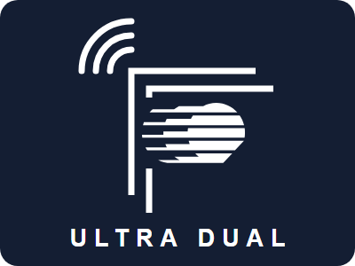
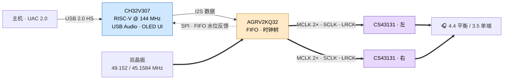

<div align="center">



# ULTRA DUAL

**UAC 2.0 → I2S asynchronous USB sound card** · 异步 USB 声卡

`CH32V307` × `AGRV2KQ32` × `2 × CS43131` — 用 MCU + CPLD 实现的全异步 USB 音频接口，可替代 Amanero / XMOS 方案

[](https://github.com/MWT6433/USBAudioToI2S/releases/tag/v1.1.0)
[](#-下载与烧写)
[](#-下载与烧写)
[](#-构建)
[](#-构建)
[](#-特性总览)
[](LICENSE)

</div>

---

## ⚡ 信号链



**全异步**：MCU 用硬件定时器实测 FIFO 水位，在 SOF 中断中动态修正 USB 反馈值。音频时钟始终来自双晶振，与主机时钟彻底解耦。

## ✨ 特性总览

<table>
<tr>
<td valign="top" width="50%">

#### 🎵 USB 音频
- UAC 2.0，采样率 **44.1 – 384 kHz 全覆盖**（44.1k / 48k 双族）
- 16 / 24 / 32 bit 运行时切换
- 音量可选跟随主机混音器（`ENABLE_USB_VOLUME_FOLLOW`）

#### 🕰 时钟架构（nopll）
- 双晶振 **49.152 + 45.1584 MHz** 直出 DAC MCLK
- MCLK 默认 **2× 直驱**（调制器 OSR 翻倍，实测更优）
- PLL 只出 122.88 MHz；48k 族直分；MCK 两族统一 1024×Fs

#### 🎛 OLED 用户界面
- 主界面：音量 · 采样率 · 插孔模式（4.4 / 3.5 mm）
- 旋转编码器 + 按键状态机（单击 / 双击 / 长按）
- 空闲自动调光；音量掉电保存（Magic + CRC）

</td>
<td valign="top" width="50%">

#### 🎚 DAC 完整控制
- 双 CS43131（I2C `0x30` / `0x31`）立体声
- 滤波 Fast / Slow · Latency / Phase · HPF · WBF · NOS
- Class H / AB · HP FS 增益
- **Balance 平衡菜单**（±10 dB / 0.5 dB 步进，Flash 平滑升级）
- 插拔检测 · 动态电源管理 · ASP 错误解读

#### 🔧 自托管调试
- **DAP 模式**：MCU 模拟 CMSIS-DAP，直烧 CPLD，无需专用烧写器
- 空片 CPLD 上电**自动进入 DAP 模式**，不再挂死
- MCU / CPLD 两侧均支持纯 CLI 构建

#### 🔌 引脚重定义（v1.1.0 · 新板）
- RST 合并至 **PD8** · INT → **PD9**
- FIFO 状态全走 SPI 上报（`GET_SILENCE 0xE0`），删除专用引脚

</td>
</tr>
</table>

## 📦 下载与烧写

最新固件与位流见 **[Release v1.1.0](https://github.com/MWT6433/USBAudioToI2S/releases/tag/v1.1.0)**：

| 资产 | 用途 |
|---|---|
| `USBAudio.hex` / `.bin` | MCU 固件 — WCH-LinkUtility 或 MRS 烧写 |
| `audio_cpld_v6_bc28.bin` | CPLD 位流 — 28 种子批量时序优选（#28） |
| `bc_summary.txt` | 28 种子时序收敛汇总报告 |
| `USBAudio.map` | 固件链接 map（调试参考） |

> ⚠️ **位流必须配双晶振**（49.152 + 45.1584 MHz）。需要标称 MCLK 时请用固件 **0xC0 菜单**切换，不要更换晶振。
>
> CPLD 可通过板载 **DAP 模式**烧写（SWD：PB1 / PC5 / PA3），无需专用烧写器。

## 🔨 构建

<details>
<summary><b>MCU 固件（CH32V307）</b></summary>

用 [MounRiver Studio](https://www.wch.cn/products/CH32V307.html) 导入工程根目录直接构建；
也可使用 MRS 在 `obj/` 生成的 makefile 走命令行（`make all`）。

编译开关见 `User/app_config.h`：`ENABLE_USB_VOLUME_FOLLOW`、`BOARD_HAS_SI5351`。

</details>

<details>
<summary><b>CPLD 固件（AGRV2KQ32）</b></summary>

用 AGM [Supra 工具链](http://www.tcx-micro.com/doc_27047096.html) 打开 `AGRV2KQ32/1/` 工程编译；发布位流建议开 Batch 多种子取优（本仓库发布件即 batch 优选结果）。
如需改用外部 PLL，参考 `AGRV2KQ32/1/pll_nopll.v` 替换对应 PLL 实例。

</details>

## 🗂 目录结构

```text
├── User/            # 应用层：USB 音频、CS43131、OLED UI、DAP、设置存储
├── Peripheral/      # CH32V307 外设库
├── Core/ Startup/   # 内核与启动文件
├── Ld/ Debug/       # 链接脚本、调试支撑
├── AGRV2KQ32/1/     # CPLD 工程（Verilog + SDC + QSF）
├── docs/logo/       # ULTRA DUAL logo 与丝印图形
├── CHANGELOG.md     # 版本史（含每个菜单/寄存器级细节）
└── LICENSE          # Apache-2.0
```

## 🔗 硬件

- **原理图**（OSHWhub）：<https://oshwhub.com/lovelonelytime/usbtoi2s>
- **双晶振必配**：49.152 MHz + 45.1584 MHz
- **MCLK 2× 说明**：晶振频率为 DAC 标称值（24.576 / 22.5792 MHz）的两倍，超出规格但保持整数比（详见 `User/cs43131.h` 注释）。听感对比定论 2× 直驱优于 ÷2，标称值可经 0xC0 菜单切换。

## 📜 许可与致谢

[Apache-2.0](LICENSE) · 基于 WCH CH32V307 外设库、[U8g2](https://github.com/olikraus/u8g2) 图形库与 ARM CMSIS-DAP 协议实现 · CS43131 是 Cirrus Logic 的产品

---

<div align="center"><sub>⌜⌜ ULTRA DUAL — USB in, balance out.</sub></div>
